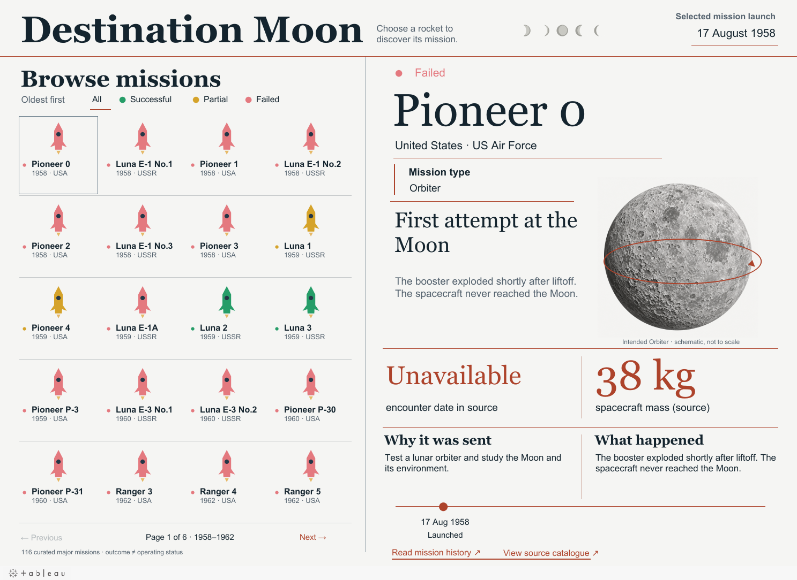

# Destination Moon

**An interactive Tableau project exploring 116 selected lunar missions.**

I started researching the Moon race during the Cold War and became interested in the missions behind the famous milestones. Why were they sent? Which achieved their goals? What happened when they failed? I built this dashboard to make those stories easy to explore, one mission at a time.

**[Open the live dashboard](https://public.tableau.com/app/profile/shashank.pabitwar/viz/Moon_missions/DestinationMoon)** · **[Download the editable Tableau workbook](https://github.com/Shashankpabitwar123/destination-moon/raw/refs/heads/main/tableau/Moon_missions.twbx)**

*Preview exported from the published Tableau dashboard. Open the live version to select missions and use the filters.*

## How the project came together

### 1. Start with the mission records

I used [NASA's Moon Missions catalogue](https://science.nasa.gov/moon/missions/) as the starting point, then added details from mission histories, NASA's Deep Space Chronicle and other sources linked in the data. The selected records span 1958–2026.

### 2. Make the records consistent

Python helped standardize names and dates, classify outcomes and combine some rovers and secondary payloads with their parent missions. I kept source links and documented corrections so readers can trace the information.

| Outcome | Missions |
|---|---:|
| Successful | 64 |
| Failed | 43 |
| Partially successful | 9 |
| **Total selected missions** | **116** |

These are selected major missions, **not a complete count of every lunar mission or rocket launch**. A mission can achieve its objectives and continue operating; outcome and current operating status are different.

### 3. Turn the records into an interactive dashboard

- Browse 20 missions at a time, ordered by launch date.
- Click a rocket or mission name to update the details panel.
- Filter by successful, failed or partially successful outcomes.
- Read why a mission launched, what happened and its recorded milestones.
- Follow the source links for more information.

The year and country remain under each rocket. Colours and matching dots communicate outcomes. The right panel brings the mission's purpose, results and key facts together.

## What I used

| Tool | Role |
|---|---|
| Python | Prepare and check the mission catalogue |
| Tableau | Build the interactive gallery, filters and mission details |
| Hyper | Package the data inside the downloadable workbook |

## Explore the files

- [Final Tableau workbook](tableau/Moon_missions.twbx) — the final user-tested version, with its data and images packaged inside.
- [Mission data](data/missions.csv) — exported directly from the final workbook's Hyper extract; includes display/helper fields.
- [Curated catalogue](data/catalog.json) — mission facts and source links before Tableau display formatting.
- [Preparation script](scripts/prepare_catalog.py) — prepares the catalogue from the included source snapshots.
- [Methods and limitations](docs/methodology.md) — inclusion decisions, outcome definitions, date corrections and sources.
- [Opening and reproduction guide](docs/how-to-use.md).

The Moon illustration and arrows explain mission types. They are **not actual flight paths, landing locations or mission photographs**. Missing facts are shown as unavailable. The dataset is a dated snapshot, not a live mission tracker.

**Built by Shashank Pabitwar.**
